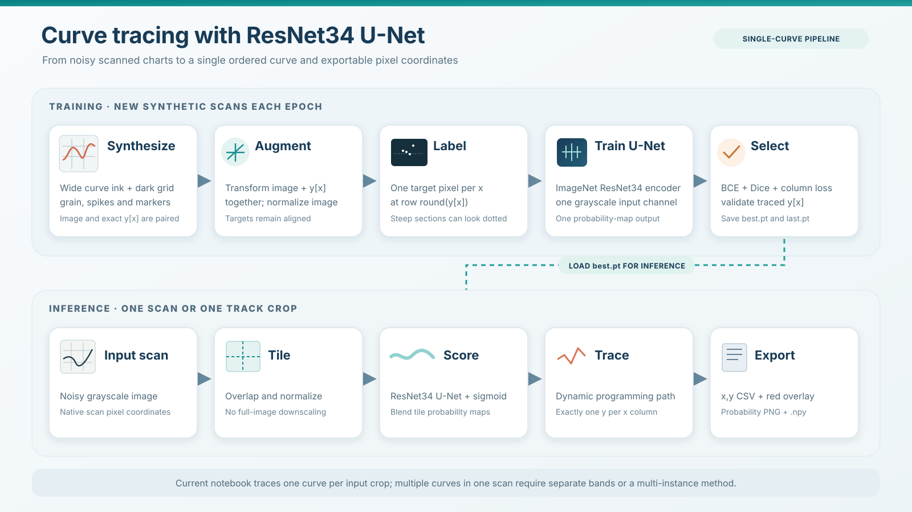

# Noisy curve tracing with ResNet34 U-Net

This project digitizes **one curve per scanned image or crop**. A Kaggle notebook generates noisy synthetic graph-paper scans in memory, trains a grayscale ResNet34 U-Net, and turns its probability map into one ordered `y` coordinate for every image column.

## How it works

1. Generate synthetic scans with a visible 2–5 px curve, dark grid and reference lines, grain, and narrow peaks and dips. The target marks **one centerline pixel per column**.
2. Augment each image and its exact `y[x]` coordinates together. Train an ImageNet-initialized ResNet34 U-Net with weighted BCE, Dice, and a column-wise center-row loss.
3. Select `best.pt` using trace accuracy on fixed synthetic validation images, or on optional labeled real validation scans.
4. At inference, predict overlapping tiles at native resolution, blend their probability maps, and run a dynamic-programming tracker constrained to one `y` per `x`.
5. Export an `x,y` CSV, a red trace overlay, a viewable probability PNG, and an exact floating-point probability `.npy` file.

## Run on Kaggle

1. Import [the notebook](notebooks/curve-trace-resnet-centerline.ipynb) into a Kaggle Notebook. Enable **GPU** and **Internet** in its settings; pretrained encoder weights need Internet on the first run.
2. Run the cells in order. The defaults generate 2,000 new training images per epoch for 25 epochs; the synthetic dataset is not saved. Check the preview before training.
3. The notebook writes `best.pt`, `last.pt`, and training history under `/kaggle/working/curve_resnet34_centerline_v1`. Save a Kaggle notebook version to retain those files as version outputs.
4. For your scans, attach an image dataset and set `IMAGE_PATHS` in the final inference cell. Leave `REAL_VAL_DIR = ''` if you do not have manually labeled real validation data.

The notebook is source-only: **trained weights, real scans, and prediction outputs are not included**. Download `best.pt` from your Kaggle output if you need the trained model elsewhere. Share large weights separately, such as through a GitHub Release, rather than committing them into regular Git history.

## Scope and limitations

- The current model and DP tracker produce **one trace per input crop**. Multiple curves in one scan require separate crops/bands or a different multi-instance tracker.
- A one-pixel-per-column target can appear disconnected at steep transitions. The tracker still returns one `y[x]` for each column; genuinely vertical segments with several `y` values at the same `x` cannot be represented by that output format.
- Synthetic validation scores do not prove accuracy on real scans. Review probability maps and overlays, and use manually labeled real validation scans when possible.

## Files

| Path | Purpose |
| --- | --- |
| [`notebooks/curve-trace-resnet-centerline.ipynb`](notebooks/curve-trace-resnet-centerline.ipynb) | Clean Kaggle notebook, with execution outputs and personal input paths removed |
| [`assets/curve_trace_resnet34_pipeline.svg`](assets/curve_trace_resnet34_pipeline.svg) | Scalable README architecture diagram |
| [`assets/curve_trace_resnet34_pipeline.png`](assets/curve_trace_resnet34_pipeline.png) | PNG version of the diagram |
| [`requirements.txt`](requirements.txt) | Main Python packages used by the notebook |
